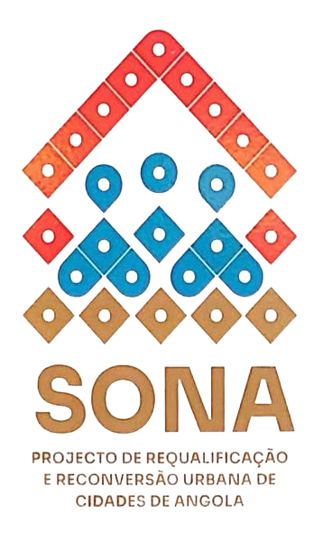

<p align="center">
  
</p>

<h1 align="center">G.TERRAS</h1>

<p align="center">
  <strong>Base de Dados Provincial de Gestão de Terras — Província da Huíla</strong><br>
  Sistema de informação do INOTU para a gestão integrada de processos fundiários, loteamentos, instrumentos de ordenamento territorial e operações urbanísticas.
</p>

<p align="center">
  
  
  
  
  
  
</p>

---

## Índice

- [Sobre o Projecto](#sobre-o-projecto)
- [Funcionalidades](#funcionalidades)
- [Stack Tecnológico](#stack-tecnológico)
- [Requisitos](#requisitos)
- [Instalação](#instalação)
- [Desenvolvimento](#desenvolvimento)
- [Estrutura do Projecto](#estrutura-do-projecto)
- [Módulos](#módulos)
- [Editor Geoespacial](#editor-geoespacial)
- [Controlo de Acesso](#controlo-de-acesso)
- [Testes](#testes)
- [Licença](#licença)

---

## Sobre o Projecto

O **G.TERRAS** é o sistema de gestão da Base de Dados Provincial de Terras da Província da Huíla, desenvolvido no âmbito do **Projecto SONA** para o **INOTU** (Instituto Nacional de Ordenamento do Território e Urbanismo) — República de Angola.

O sistema digitaliza e moderniza os processos de gestão fundiária, permitindo o registo, acompanhamento e emissão de pareceres sobre processos de concessão de terras, com cobertura dos **22 municípios** da província.

### Instituições

| Instituição | Papel |
|---|---|
| **INOTU** | Instituto Nacional de Ordenamento do Território e Urbanismo |
| **MINOPUH** | Ministério das Obras Públicas, Urbanismo e Habitação |
| **Projecto SONA** | Programa de gestão fundiária provincial |

---

## Funcionalidades

### Gestão Territorial
- Organização hierárquica: Província → Município → Comuna
- Instrumentos de ordenamento do território e urbanísticos
- Cartas municipais
- Controlo de loteamentos urbanos com registo de lotes

### Processos Fundiários
- Registo, tramitação e emissão de pareceres
- Rastreabilidade completa do fluxo processual
- QR Code em documentos para verificação digital

### Operações Urbanísticas
- Croquis elaborados
- Terrenos ociosos
- Gestão de pareceres técnicos
- Licenciamento e fiscalização

### Projectos de Requalificação
- Projecto SONA
- Outros projectos de requalificação urbana

### Editor Geoespacial (GIS)
- Mapa interactivo baseado em OpenLayers 10
- Desenho e edição de parcelas (polígonos, linhas, pontos)
- 15 tipos de terreno pré-configurados
- Importação de ficheiros QGIS
- Exportação multi-formato: **GeoJSON**, **KML**, **DXF**, **CSV**
- Detecção de limites municipais
- Interface QGIS-like com painel de camadas e propriedades

### Auditoria & Relatórios
- Registo completo de todas as acções (log de acesso)
- Trilha de auditoria por utilizador
- Monitorização e análise de dados

### Autenticação & Segurança
- Autenticação com verificação de e-mail
- Autenticação de dois factores (2FA) com códigos de recuperação
- Recuperação de palavra-passe

---

## Stack Tecnológico

| Componente | Tecnologia |
|---|---|
| **Backend** | Laravel 12 · PHP 8.2+ |
| **Frontend** | Livewire 4 · Flux UI 2.9 · Tailwind CSS 4 |
| **Base de Dados** | SQLite (modo WAL) |
| **GIS / Mapas** | OpenLayers 10 |
| **Build** | Vite 7 · Node.js 22 |
| **Testes** | Pest 4 · PHPUnit |
| **Auth** | Laravel Fortify (2FA, email verification) |
| **Linting** | Laravel Pint |

---

## Requisitos

- **PHP** ≥ 8.2 (com extensões: sqlite3, pdo_sqlite, mbstring, openssl, tokenizer)
- **Composer** ≥ 2.x
- **Node.js** ≥ 22.x
- **npm** ≥ 10.x

---

## Instalação

```bash
# 1. Clonar o repositório
git clone <url-do-repositorio> inotu
cd inotu

# 2. Instalar dependências (PHP e Node)
composer install
npm install

# 3. Configurar ambiente
cp .env.example .env
php artisan key:generate

# 4. Criar e migrar a base de dados
touch database/database.sqlite
php artisan migrate

# 5. (Opcional) Popular com dados de exemplo
php artisan db:seed

# 6. Compilar assets
npm run build

# 7. Iniciar o servidor
php artisan serve
```

Ou, em alternativa, utilizando o script `setup` do Composer:

```bash
composer setup
php artisan serve
```

---

## Desenvolvimento

Para iniciar o ambiente de desenvolvimento com servidor, fila e Vite em simultâneo:

```bash
composer dev
```

Este comando executa em paralelo:
- `php artisan serve` — Servidor HTTP
- `php artisan queue:listen` — Processamento de filas
- `npm run dev` — Vite em modo HMR

### Comandos úteis

| Comando | Descrição |
|---|---|
| `npm run dev` | Vite em modo de desenvolvimento (HMR) |
| `npm run build` | Compilar assets para produção |
| `composer lint` | Formatar código com Pint |
| `composer lint:check` | Verificar formatação sem alterar |
| `composer test` | Executar testes completos |
| `php artisan migrate` | Executar migrations |
| `php artisan tinker` | Console interactivo |

---

## Estrutura do Projecto

```
inotu/
├── app/
│   ├── Actions/Fortify/         # Acções de autenticação (Fortify)
│   ├── Concerns/                # Traits partilhadas (TemPermissoes, validações)
│   ├── Http/Controllers/        # Controllers (MapController para API GIS)
│   ├── Livewire/                # 25+ componentes Livewire
│   │   └── Actions/             # Acções Livewire (Logout)
│   ├── Models/                  # Eloquent models
│   └── Providers/               # Service providers
│
├── config/                      # Configuração Laravel + Fortify
│
├── database/
│   ├── factories/               # Factories do Eloquent
│   ├── migrations/              # 21 migrations (users, municípios, instrumentos, etc.)
│   └── seeders/                 # Seeders
│
├── public/
│   ├── imagens/                 # Logos institucionais (INSIGNIA, INOTU, SONA, MINOPUH)
│   └── build/                   # Assets compilados (Vite)
│
├── resources/
│   ├── css/
│   │   ├── app.css              # Estilos da aplicação
│   │   └── editor.css           # Estilos do editor GIS (~1300 linhas)
│   ├── js/
│   │   ├── app.js               # Ponto de entrada JS
│   │   └── editor/              # Módulos do editor GIS
│   │       ├── MapEditor.js     # Classe principal do editor (~680 linhas)
│   │       ├── PropertyPanel.js # Painel de propriedades
│   │       ├── LayerPanel.js    # Painel de camadas
│   │       ├── ModalManager.js  # Gestão de modais
│   │       └── ContextMenu.js   # Menu de contexto
│   └── views/
│       ├── welcome.blade.php    # Página pública (landing page)
│       ├── livewire/            # 25 views de componentes Livewire
│       ├── pages/               # Auth + Settings
│       ├── layouts/             # Layouts (app, auth)
│       └── components/          # Componentes Blade
│
├── routes/
│   ├── web.php                  # Rotas web + API GIS (sessão)
│   └── settings.php             # Rotas de configurações/perfil
│
└── tests/
    ├── Feature/                 # Testes de integração
    │   ├── Auth/                # Testes de autenticação
    │   └── Settings/            # Testes de configurações
    └── Unit/                    # Testes unitários
```

---

## Módulos

### Municípios
Gestão dos 22 municípios da Província da Huíla com dados geográficos (centro, bounding box), comunas associadas e navegação contextual.

### Instrumentos de Ordenamento
- **Instrumentos de Ordenamento do Território** — Planos directores, planos de pormenor
- **Instrumentos Urbanísticos** — Regulamentos, normas urbanísticas
- **Cartas Municipais** — Cartografia temática municipal

### Loteamentos
Registo e controlo de loteamentos urbanos por município, com gestão de lotes individuais e estado de aprovação.

### Operações Urbanísticas
- Croquis elaborados
- Terrenos ociosos
- Pareceres técnicos sobre operações urbanísticas

### Projectos de Requalificação
- **Projecto SONA** — Gestão centralizada do projecto de requalificação
- **Outros Projectos** — Projectos adicionais de requalificação urbana

### Auditoria
Sistema completo de logs de acesso e trilha de auditoria com registo de todas as acções realizadas no sistema.

---

## Editor Geoespacial

O editor GIS integrado permite a visualização e edição de dados geoespaciais directamente no browser.

### Arquitectura

```
MapEditor.js (classe principal)
├── LayerPanel.js      → Gestão de camadas (visibilidade, cor, ordenação)
├── PropertyPanel.js   → Edição de propriedades das features
├── ModalManager.js    → Diálogos (exportar, importar, camadas)
└── ContextMenu.js     → Menu de contexto no mapa
```

### API REST (sessão web)

| Método | Endpoint | Descrição |
|---|---|---|
| `GET` | `/api/maps/tipos` | Listar tipos de camada |
| `GET` | `/api/maps/{municipio}/layers` | Listar camadas |
| `POST` | `/api/maps/{municipio}/layers` | Criar/obter camada |
| `PATCH` | `/api/maps/layers/{layer}` | Actualizar camada |
| `GET` | `/api/maps/{municipio}/features` | Listar features (GeoJSON) |
| `GET` | `/api/maps/{municipio}/sync` | Sincronizar dados |
| `POST` | `/api/maps/{municipio}/features` | Criar feature |
| `PUT` | `/api/maps/features/{feature}` | Actualizar feature |
| `DELETE` | `/api/maps/features/{feature}` | Remover feature |
| `GET` | `/api/maps/{municipio}/info` | Info do município (centro, bbox) |
| `GET` | `/api/maps/{municipio}/export` | Exportar GeoJSON |
| `GET` | `/api/maps/{municipio}/export/kml` | Exportar KML |
| `GET` | `/api/maps/{municipio}/export/dxf` | Exportar DXF |
| `GET` | `/api/maps/{municipio}/export/csv` | Exportar CSV |
| `POST` | `/api/maps/parse-qgis` | Importar ficheiro QGIS |

---

## Controlo de Acesso

O sistema implementa controlo de acesso baseado em papéis (RBAC) com 4 níveis hierárquicos:

| Nível | Descrição | Âmbito |
|---|---|---|
| **INOTU** | Administração central | Acesso total ao sistema |
| **Provincial** | Delegação provincial | Todos os municípios da província |
| **Municipal** | Administração municipal | Município atribuído |
| **Técnico** | Operador técnico | Funcionalidades limitadas |

### Permissões

As rotas são protegidas pelo middleware `permissao:` com as seguintes permissões:

- `instrumentos.ver` — Visualizar instrumentos de ordenamento
- `loteamentos.ver` — Visualizar loteamentos
- `operacoes.ver` — Visualizar operações urbanísticas
- `pareceres.ver` — Visualizar pareceres
- `sona.ver` — Visualizar projectos de requalificação
- `usuarios.ver` — Gestão de utilizadores
- `auditoria.ver` — Visualizar registos de auditoria

---

## Testes

O projecto utiliza **Pest 4** como framework de testes.

```bash
# Executar todos os testes
php artisan test

# Executar testes com cobertura
php artisan test --coverage

# Executar suite específica
php artisan test --testsuite=Feature

# Executar com lint check
composer test
```

A configuração de testes usa SQLite em memória (`:memory:`) para execução rápida.

---

## Licença

Projecto desenvolvido para o **INOTU** — Instituto Nacional de Ordenamento do Território e Urbanismo, República de Angola.

<p align="center">
  
  &nbsp;&nbsp;
  
  &nbsp;&nbsp;
  
  &nbsp;&nbsp;
  
</p>

<p align="center">
  <sub>© 2026 G.TERRAS — INOTU · Delegação Provincial da Huíla · República de Angola</sub>
</p>
